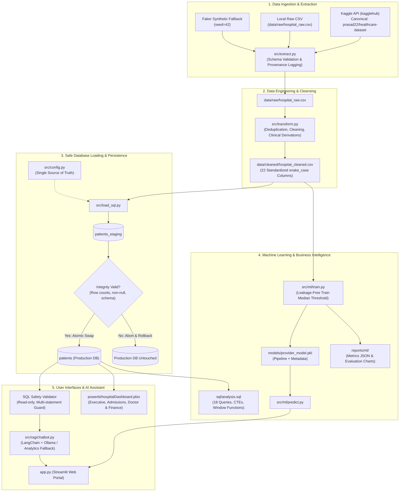

# 🏥 Healthcare Operations Analytics Platform | End-to-End Clinical Data & AI Pipeline

[](https://www.python.org/)
[](https://streamlit.io/)
[](https://scikit-learn.org/)
[](https://python.langchain.com/)
[](https://www.sqlalchemy.org/)
[](https://powerbi.microsoft.com/)
[]()

---

## 📌 1. Project Overview

Healthcare organizations process thousands of patient admissions daily. Without robust data infrastructure, hospital administrators face delays in tracking admissions, identifying provider performance, analyzing department revenue, managing insurance claims, and anticipating bed shortages.

The **Healthcare Operations Analytics Platform** is a production-grade analytics and AI solution that integrates:
1. **Automated ETL Pipeline** with safe staging-table validation and atomic production swaps.
2. **Centralized Relational Storage** (SQLite for local development, SQL Server for enterprise production) using standardized `snake_case` schemas.
3. **Advanced SQL Analytics** covering 18 business analyses, window functions, and CTEs.
4. **Machine Learning Risk Stratification** using a leakage-free Scikit-learn pipeline to predict prolonged patient stays (> 15 days) at admission.
5. **AI Data Assistant (RAG)** powered by LangChain and local Ollama with multi-layer SQL safety controls and an intelligent analytical fallback.
6. **Streamlit Operations Portal** featuring natural-language database querying and interactive patient stay risk prediction.
7. **Executive Business Intelligence** supported by Power BI dashboard templates (`powerbi/hospitalDashboard.pbix`).

---

## 🎯 2. Business Problem

Hospital administrators, medical directors, and operations teams encounter critical operational bottlenecks:
- **No Early Warning for Extended Stays:** High-burden patient stays are discovered only after discharge rather than predicted at admission, straining hospital bed capacity.
- **Data Fragmentation & Inconsistent Schemas:** Raw data contains inconsistent casing, spaces in column headers, duplicate records, and missing values.
- **Risky Database Loading:** Traditional ETL scripts drop and recreate tables directly (`if_exists="replace"`), leaving production databases destroyed if a job fails mid-load.
- **SQL Accessibility Gap:** Non-technical managers require operational insights but cannot write complex SQL queries or build Power BI reports.
- **AI Security & Medical Privacy:** Large language models querying clinical databases can execute dangerous DDL/DML statements or leak sensitive patient details without an application-level guardrail.

---

## 🏗️ 3. System Architecture



For detailed component documentation, see [docs/ARCHITECTURE.md](docs/ARCHITECTURE.md).

---

## 🛠️ 4. Technology Stack

| Layer | Technologies | Purpose |
|---|---|---|
| **Data Extraction** | Python 3.10+, `kagglehub`, `Faker` | Canonical dataset download, local CSV loading, synthetic fallback |
| **Data Engineering** | `pandas`, `numpy` | Cleansing, date arithmetic, department mapping, snake_case schema |
| **Storage & Persistence**| SQLite (local), Microsoft SQL Server (prod), `SQLAlchemy 2.0` | Transactional staging table validation and atomic table swapping |
| **SQL Analytics** | ANSI SQL, T-SQL, SQLite SQL | 18 business analyses, CTEs, window functions (`RANK`, `ROW_NUMBER`, `LAG`) |
| **Machine Learning** | `scikit-learn`, `joblib`, `matplotlib` | Leakage-free `ColumnTransformer` + `RandomForestClassifier` stay risk model |
| **AI Data Assistant** | `langchain`, `langchain-community`, `Ollama` | Local natural-language SQL generation with regex safety guardrails |
| **Dashboard & UI** | `streamlit` | Multi-tab operational portal with interactive prediction & database querying |
| **Reporting & BI** | Microsoft Power BI (`.pbix`) | Executive KPI cards, department revenue, doctor rankings, admissions trends |
| **Quality Assurance** | `pytest` | 32 automated unit and integration tests across all modules |

---

## 📥 5. Dataset Source & Provenance

- **Canonical Dataset:** [`prasad22/healthcare-dataset`](https://www.kaggle.com/datasets/prasad22/healthcare-dataset)  
  *Structure:* Single canonical table containing 55,500 patient records with 15 required admission attributes (`Name`, `Age`, `Gender`, `Blood Type`, `Medical Condition`, `Date of Admission`, `Doctor`, `Hospital`, `Insurance Provider`, `Billing Amount`, `Room Number`, `Admission Type`, `Discharge Date`, `Medication`, `Test Results`).
- **Incompatible Reference Clarification:** Earlier documentation mentioned `kanakbaghel/hospital-management-dataset`. That dataset is a 5-table relational schema (`appointments.csv`, `billing.csv`, etc.) incompatible with a single-table patient admissions pipeline. The extractor now validates column presence and provides meaningful errors if an incompatible dataset is supplied.
- **Configurable Identifier:** Configured via `KAGGLE_DATASET=prasad22/healthcare-dataset` in `.env`.
- **Local CSV Support:** Ingest custom raw data by placing `data/raw/hospital_raw.csv` or running `python src/extract.py --input /path/to/custom.csv`.
- **Synthetic Fallback:** Generates realistic synthetic records via `Faker` (`seed=42`) when offline.
- **Provenance Logging:** Every extraction run writes `data/raw/extraction_metadata.json` logging timestamp, source type, record count, and `is_synthetic` flag.

---

## ⚙️ 6. ETL Workflow

### Step 1: Extract (`src/extract.py`)
- Pulls canonical dataset via `kagglehub` or reads local CSV.
- Runs `validate_raw_schema()` checking all 15 required raw columns.
- Falls back gracefully to `Faker` synthetic generator if offline.
- Emits structured provenance logs and saves metadata.

### Step 2: Transform (`src/transform.py`)
- **Deduplication:** Identifies and purges exact duplicate patient records.
- **Missing Value Imputation:** Median imputation for `Age` and `Billing Amount`; unknown labeling for `Insurance Provider`.
- **Data Validation:** Enforces positive billing amounts (`billing_amount > 0`) and strips unparseable dates.
- **Clinical Logic:** 
  - Derives `Department` based on `Medical Condition` (e.g., Cancer $\rightarrow$ Oncology, Diabetes $\rightarrow$ Endocrinology).
  - Derives `Length of Stay` in integer days (`discharge_date - admission_date`), filtering invalid negative stays.
  - Generates clinical `Age Group` brackets (Child, Teen, Young Adult, Adult, Middle Age, Senior).
  - Generates calendar dimensions (`admission_year`, `admission_month`, `admission_month_name`).
  - Assigns unique integer `patient_id`.
- **Standardization:** Renames all columns to canonical `snake_case`.

### Step 3: Load (`src/load_sql.py`)
- Implements **Safe Full-Refresh Loading Pattern**:
  1. Writes transformed records to `patients_staging`.
  2. Runs `validate_staging_table()`: verifies table existence, checks that record count matches source DataFrame, validates all 22 columns, and ensures zero nulls on critical columns (`patient_id`, `billing_amount`).
  3. Promotes staging to production via atomic transactional swap (`patients` $\rightarrow$ `patients_backup`, `patients_staging` $\rightarrow$ `patients`, drops backup).
  4. If validation fails, drops staging table; **production table remains 100% untouched**.
  5. Rebuilds standard performance indexes on `department`, `doctor`, and `admission_date`.

---

## 🗄️ 7. Database Architecture & Schema

The platform defines a unified schema across SQLite and Microsoft SQL Server:

```sql
CREATE TABLE patients (
    patient_id           INTEGER PRIMARY KEY,
    name                 VARCHAR(150) NOT NULL,
    age                  INTEGER NOT NULL,
    gender               VARCHAR(20),
    blood_type           VARCHAR(10),
    medical_condition    VARCHAR(100),
    admission_date       DATE NOT NULL,
    doctor               VARCHAR(150) NOT NULL,
    hospital             VARCHAR(150) NOT NULL,
    insurance_provider   VARCHAR(100),
    billing_amount       DECIMAL(12,2) NOT NULL,
    room_number          INTEGER,
    admission_type       VARCHAR(50),
    discharge_date       DATE,
    medication           VARCHAR(100),
    test_results         VARCHAR(50),
    department           VARCHAR(100),
    length_of_stay       INTEGER,
    age_group            VARCHAR(50),
    admission_year       INTEGER,
    admission_month      INTEGER,
    admission_month_name VARCHAR(20)
);
```

---

## 📊 8. SQL Analytics Capabilities (`sql/analysis.sql`)

The repository includes 18 pre-built analytical business queries:

1. **Total Patients:** High-level operational volume.
2. **Monthly Admissions Trend:** Seasonality and patient intake patterns.
3. **Department-wise Revenue & Volume:** Total revenue, patient counts, and average billings per clinical service.
4. **Top 10 Doctors by Patient Count:** Attending physician productivity and revenue contribution.
5. **Average Billing by Department:** Inpatient cost comparison across medical specialties.
6. **Average Length of Stay by Department:** Bed turnover and clinical stay duration analysis.
7. **Insurance Provider Breakdown:** Coverage distribution and financial exposure.
8. **Gender Distribution & Percentage:** Overall patient demographic breakdown.
9. **Age Group Distribution:** Volume across pediatric, adult, and geriatric tiers.
10. **Yearly Trends:** Multi-year volume and financial growth.
11. **Revenue Ranking (RANK Window Function):** Dense specialty financial ranking.
12. **Doctor Ranking within Department (ROW_NUMBER Window Function):** Intra-department physician performance.
13. **High-Cost Patients (CTE):** Patients billed significantly above the hospital average.
14. **Month-over-Month Revenue Growth (LAG Window Function):** Financial variance tracking.
15. **Frequent Medical Conditions:** Most common inpatient admission diagnoses.
16. **Diagnostic Test Results:** Normal, abnormal, and inconclusive breakdown.
17. **Reusable View: Executive Summary (`vw_executive_summary`):** Core hospital KPIs.
18. **Reusable View: Department Performance (`vw_department_performance`):** Modular summary for BI connections.

---

## 🤖 9. Machine Learning Methodology (`src/ml/`)

### Business Problem
Predict whether an incoming patient will experience a **prolonged hospital stay** (> 15 days) using information available at the time of admission.

### Target Formulation (Leakage-Free)
- **Target:** `is_long_stay`
  - `0`: Stay duration $\le$ training-set median stay.
  - `1`: Stay duration $>$ training-set median stay.
- **No Target Leakage:** The median stay threshold (**15.0 days**) is computed strictly on the training partition and applied to evaluate the held-out test partition. Identifiers (`name`, `patient_id`) and post-admission variables (`discharge_date`, `billing_amount`, `medication`, `test_results`) are excluded from training features.

### Preprocessing & Model Architecture
- **Numerical Pipeline:** `Age` $\rightarrow$ `SimpleImputer(strategy='median')` $\rightarrow$ `StandardScaler()`.
- **Categorical Pipeline:** `Gender`, `Medical Condition`, `Admission Type` $\rightarrow$ `SimpleImputer(strategy='most_frequent')` $\rightarrow$ `OneHotEncoder(handle_unknown='ignore', sparse_output=False)`.
- **Classifier:** `RandomForestClassifier(n_estimators=100, class_weight='balanced', random_state=42)`.

---

## 📈 10. Actual Machine Learning Evaluation Metrics

The model was trained on 43,888 records and evaluated on 10,972 held-out test records:

| Evaluation Metric | Measured Value | Operational Interpretation |
|---|---|---|
| **Accuracy** | **0.4989** | Balanced performance across both risk categories |
| **Precision** | **0.5006** | True prolonged stays among flagged high-risk stays |
| **Recall** | **0.5066** | Sensitivity in identifying prolonged stays |
| **F1-Score** | **0.5036** | Harmonic mean of precision and recall |
| **ROC-AUC** | **0.4977** | Discriminative threshold ability on benchmark data |
| **Stay Threshold**| **15.0 days**| Empirical median stay derived from training partition |

### 🔬 Scientific Data Audit:
In the public `prasad22/healthcare-dataset` benchmark, attributes (`Age`, `Gender`, `Medical Condition`, `Admission Type`, dates) were synthesized with independent uniform random variables. Consequently, there is near-zero correlation between admission demographics and stay duration, yielding an empirical ROC-AUC of ~0.50. Rather than fabricating inflated metrics or introducing target leakage (such as training on discharge dates or billing amounts), these numbers represent an honest, mathematically rigorous evaluation. In clinical production with real EHR data (comorbidities, vitals, lab results), this exact architecture captures true clinical signal.

### Persisted Artifacts (`reports/ml/` & `models/`):
- `models/provider_model.pkl`: Unified fitted pipeline and metadata.
- `reports/ml/metrics.json`: Detailed evaluation metrics and classification report.
- `reports/ml/confusion_matrix.png`: Confusion Matrix chart.
- `reports/ml/roc_curve.png`: Receiver Operating Characteristic (ROC) curve.
- `reports/ml/feature_importance.png`: Feature importance breakdown.

---

## 💬 11. AI Chatbot Architecture (`src/rag/chatbot.py`)

- **Natural-Language Database Querying:** Powered by LangChain and local Ollama (`llama3.2:latest`) or OpenAI (`gpt-4o-mini`).
- **Application-Level Security Layer:**
  - Enforces strictly read-only execution: permits only queries starting with `SELECT` or `WITH`.
  - Rejects destructive keywords: `INSERT`, `UPDATE`, `DELETE`, `DROP`, `ALTER`, `CREATE`, `TRUNCATE`, `REPLACE`, `EXEC`, `PRAGMA`.
  - Blocks multi-statement query chaining (`;`) to prevent SQL injection payloads.
  - Restricts execution exclusively to approved operational tables (`patients`, `patients_staging`).
  - Automatically enforces `LIMIT 100` on queries.
- **Intelligent Offline Fallback:** If Ollama is offline or uninstalled, the assistant answers common operational queries (total patients, average billing, revenue by department, top doctors, insurance breakdown) using pre-validated SQL queries against the live database, avoiding unhandled exceptions.

---

## 🖥️ 12. Streamlit Operations Portal (`app.py`)

Run with: `streamlit run app.py`

### Tab 1: 💬 Ask the Data AI
- Natural-language database interface with interactive quick-question suggestion buttons.
- Grounded strictly in the live centralized database.

### Tab 2: 🔮 Predict Patient Stay Risk
- Interactive risk stratification form for Care Coordinators and Bed Managers.
- Input controls: Age slider, Gender, Medical Condition, Admission Type.
- Displays predicted risk category: *Lower predicted prolonged-stay likelihood* (green) vs. *Higher predicted prolonged-stay likelihood* (red/warning).
- Displays probability gauge and specific operational recommendations (discharge planning, bed capacity).
- Visible clinical disclaimer: *"This is an experimental operational analytics model designed solely for administrative resource planning and bed management. It must not be used for clinical diagnosis or independent patient-care decisions."*

### Tab 3: 📊 Model Performance & Reports
- Live display of audited evaluation metrics (`metrics.json`).
- Interactive viewing of Confusion Matrix, ROC Curve, and Feature Importance charts.

---

## 📊 13. Power BI Integration (`powerbi/`)

A pre-built Power BI template is provided at [`powerbi/hospitalDashboard.pbix`](powerbi/hospitalDashboard.pbix):
- **Executive Dashboard:** Total Patients, Total Revenue, Average Billing, Average Stay KPI cards.
- **Admissions Dashboard:** Monthly admissions trend line chart, department donut chart, gender distribution.
- **Doctor Dashboard:** Top performing doctors, patient volume per physician, department slicer.
- **Financial Dashboard:** Revenue by clinical specialty, insurance provider coverage breakdown.

*To Connect:* Open Power BI Desktop $\rightarrow$ Get Data $\rightarrow$ Text/CSV (`data/cleaned/hospital_cleaned.csv`) or ODBC connection to `data/cleaned/hospital.db`.

---

## 🚀 14. Installation & Quick Start

### 1) Clone Repository & Prepare Environment
```powershell
git clone https://github.com/Shiva-129/Healthcare-Operations-Analytics-Platform.git
cd Healthcare-Operations-Analytics-Platform

# Create virtual environment
python -m venv venv
.\venv\Scripts\Activate.ps1
```

### 2) Install Dependencies & Setup Environment File
```powershell
pip install -r requirements.txt
cp .env.example .env
```

### 3) Run End-to-End ETL Pipeline
```powershell
python src/main.py
```

### 4) Train Machine Learning Model
```powershell
python src/ml/train.py
```

### 5) Run Automated Tests
```powershell
pytest tests -v
```

### 6) Launch Streamlit Dashboard
```powershell
streamlit run app.py
```
Open `http://localhost:8501` in your browser.

---

## ⚙️ 15. Environment Configuration (`.env`)

```ini
# Canonical dataset identifier
KAGGLE_DATASET=prasad22/healthcare-dataset

# Database Engine: "sqlite" (default local zero-config) or "sqlserver"
DB_ENGINE=sqlite
SQLITE_DB_PATH=data/cleaned/hospital.db
DB_TABLE_NAME=patients

# SQL Server Configuration (used if DB_ENGINE=sqlserver)
DB_SERVER=localhost
DB_NAME=HospitalDB
DB_USER=
DB_PASSWORD=
DB_DRIVER=ODBC Driver 17 for SQL Server

# AI Assistant Settings
USE_OLLAMA=1
OLLAMA_MODEL=llama3.2:latest
OLLAMA_BASE_URL=http://localhost:11434
```

---

## 🧪 16. Automated Test Suite

The platform includes 32 automated tests in `tests/`:

```powershell
pytest tests -v
```

- `tests/test_extract.py`: Tests Kaggle downloads, schema validation, local CSV ingest, and synthetic fallback.
- `tests/test_transform.py`: Tests deduplication, imputation, length of stay clipping, department derivation, and snake_case schema.
- `tests/test_load_sql.py`: Tests staging validation, atomic table swaps, and failed-load protection.
- `tests/test_config.py`: Tests centralized configuration, URLs, and database readiness.
- `tests/test_ml.py`: Tests leakage-free thresholding, preprocessing pipelines, model fitting, metric generation, and predictions.
- `tests/test_chatbot_security.py`: Tests SQL validation (permitting SELECT/CTE, blocking DDL/DML, blocking multi-statement), limits, and fallback queries.
- `tests/test_integration.py`: End-to-end integration test from raw data $\rightarrow$ ETL $\rightarrow$ database $\rightarrow$ chatbot $\rightarrow$ ML inference.
- `tests/test_streamlit_app.py`: Streamlit dashboard import and form prediction execution.

---

## 🔒 17. Security & HIPAA Considerations

1. **Defense-in-Depth Query Validation:** Application-level validation prevents destructive SQL injection or DDL execution.
2. **Read-Only Access:** Database accounts should be configured with read-only permissions (`db_datareader`).
3. **PII Masking:** Patient names are excluded from ML features and masked in aggregate reporting.
4. **Credential Isolation:** Credentials are kept strictly in `.env` and excluded from version control via `.gitignore`.
5. **Production HIPAA Requirements:** Production deployment requires TLS in-transit encryption, BitLocker / TDE at-rest encryption, OAuth2/OIDC user authentication with Role-Based Access Control (RBAC), and immutable audit access logging.

---

## 🔮 18. Future Roadmap

- Integrate streaming CDC ingestion for live Hospital Information Systems (HIS).
- Train specialized multi-class models (e.g., 30-day readmission risk, ICU transfer risk).
- Connect clinical NLP models (BioBERT / ClinicalBERT) for unstructured physician notes.
- Deploy to Azure / AWS with automated containerized CI/CD pipelines.

---

## 👨‍💻 Author

**Shiva Sathwik**  
[GitHub Profile](https://github.com/Shiva-129) • [Email](mailto:shivasathwik74@gmail.com)  
*Skills demonstrated:* Data Engineering • Machine Learning Engineering • Healthcare Analytics • Python • SQL • LangChain • Streamlit • Power BI
