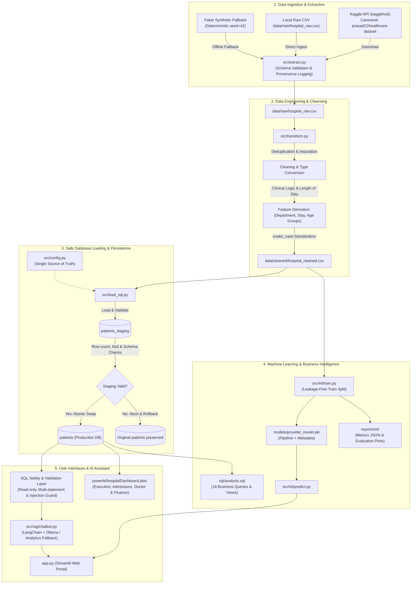
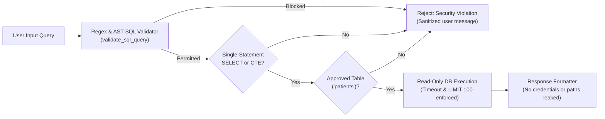

# 🏗️ Healthcare Operations Analytics Platform — System Architecture

This document describes the end-to-end architecture, data flows, components, database schema, and security layers of the **Healthcare Operations Analytics Platform**.

---

## 1. High-Level System Architecture

---

## 2. Core Architectural Principles

### A. Single Source of Truth (`src/config.py`)
- Directory paths, file locations, database connection strings, table identifiers, and hyperparameters are defined centrally.
- Prevents database divergence (resolving the previous mismatch between ETL loading into `data/cleaned/hospital.db` and the chatbot reading an empty `data/hospital_local_cache.db`).
- Seamlessly resolves local SQLite (`sqlite:///data/cleaned/hospital.db`) or enterprise Microsoft SQL Server via `DB_ENGINE` environment variable.

### B. Safe Full-Refresh Database Loading Strategy (`src/load_sql.py`)
Rather than blindly executing `if_exists="replace"` directly on the production table:
1. Cleaned records are written to an isolated staging table: `patients_staging`.
2. Staging undergoes pre-swap integrity validation:
   - Verification of exact record count matching the source DataFrame.
   - Validation that all 22 canonical schema columns exist.
   - Non-null validation on critical identifying columns (`patient_id`, `admission_date`, `billing_amount`).
3. If validation succeeds:
   - In SQLite: Atomic rename swap inside an engine transaction (`patients` -> `patients_backup`, `patients_staging` -> `patients`, drop `patients_backup`). Standard performance indexes are rebuilt immediately.
   - In SQL Server: `sp_rename` inside a transactional batch.
4. If validation fails:
   - Staging table is dropped immediately.
   - The production table remains completely untouched and operational.

### C. Leakage-Free Machine Learning Lifecycle (`src/ml/`)
- **Business Problem:** Predict whether an admitted patient is likely to experience a prolonged hospital stay (> 15 days).
- **Target Formulation:** Binary target (`is_long_stay`). The median stay duration is computed **strictly on the training partition** (derived: 15.0 days) and applied to evaluate the held-out test partition.
- **Preprocessing:** Scikit-learn `ColumnTransformer` with `SimpleImputer`, `StandardScaler`, and `OneHotEncoder(handle_unknown='ignore')`.
- **Model:** `RandomForestClassifier(class_weight='balanced', random_state=42)`.
- **Persistence:** Full preprocessing pipeline and classifier bundled into a single joblib artifact with training metadata.

---

## 3. Database Schema Specification

The platform standardizes on clean, lowercase `snake_case` column identifiers across Python, SQLite, and SQL Server:

| Column Name | Data Type | Constraint | Description |
|---|---|---|---|
| `patient_id` | INTEGER | PRIMARY KEY | Unique sequential integer patient identifier |
| `name` | VARCHAR(150) | NOT NULL | Patient full name (masked in reporting) |
| `age` | INTEGER | NOT NULL | Patient age at admission (years) |
| `gender` | VARCHAR(20) | NULLABLE | Biological sex (Male, Female) |
| `blood_type` | VARCHAR(10) | NULLABLE | ABO blood group (e.g., A+, O-, AB+) |
| `medical_condition` | VARCHAR(100) | NULLABLE | Primary admission diagnosis |
| `admission_date` | DATE | NOT NULL | Hospital admission date (ISO YYYY-MM-DD) |
| `doctor` | VARCHAR(150) | NOT NULL | Attending physician name |
| `hospital` | VARCHAR(150) | NOT NULL | Treating medical facility |
| `insurance_provider`| VARCHAR(100) | NULLABLE | Primary health insurance carrier |
| `billing_amount` | DECIMAL(12,2)| NOT NULL | Total billed charges (USD, positive) |
| `room_number` | INTEGER | NULLABLE | Inpatient room / ward number |
| `admission_type` | VARCHAR(50) | NULLABLE | Urgency tier (Emergency, Elective, Urgent) |
| `discharge_date` | DATE | NULLABLE | Hospital discharge date (ISO YYYY-MM-DD) |
| `medication` | VARCHAR(100) | NULLABLE | Primary prescribed inpatient medication |
| `test_results` | VARCHAR(50) | NULLABLE | Diagnostic lab outcome (Normal, Abnormal, Inconclusive) |
| `department` | VARCHAR(100) | NULLABLE | Clinical department (Endocrinology, Oncology, etc.) |
| `length_of_stay` | INTEGER | NULLABLE | Hospital duration in integer days (`discharge_date - admission_date`) |
| `age_group` | VARCHAR(50) | NULLABLE | Clinical age bracket (e.g., Senior 65+, Adult 36-50) |
| `admission_year` | INTEGER | NULLABLE | Calendar year of admission |
| `admission_month` | INTEGER | NULLABLE | Calendar month of admission (1 - 12) |
| `admission_month_name`| VARCHAR(20) | NULLABLE | Full calendar month name (e.g., January) |

### Supporting Indexes
- `ix_patients_department` ON `patients(department)`
- `ix_patients_doctor` ON `patients(doctor)`
- `ix_patients_admission_date` ON `patients(admission_date)`
- `ix_patients_medical_condition` ON `patients(medical_condition)`

---

## 4. AI Security & Medical Data Privacy Layer

Because healthcare systems handle sensitive operational and patient data, the platform implements defense-in-depth security:

### Security Controls:
1. **Read-Only Enforcement:** Only queries beginning with `SELECT` or `WITH` (CTEs) are allowed. Destructive keywords (`INSERT`, `UPDATE`, `DELETE`, `DROP`, `ALTER`, `CREATE`, `TRUNCATE`, `EXEC`, `PRAGMA`, etc.) are blocked at the application level.
2. **Multi-Statement Blocking:** Query chaining via semicolons (`;`) is strictly forbidden to prevent SQL injection payloads.
3. **Table Allowlisting:** Queries are restricted exclusively to approved operational tables (`patients`, `patients_staging`).
4. **Execution Safeguards:** Enforces `LIMIT 100` if no row limit is specified.
5. **Credential Isolation:** API keys, database passwords, and connection strings are stored exclusively in `.env` (gitignored). `.env.example` contains placeholders only.
6. **Graceful Offline Fallback:** If local Ollama is offline or uninstalled, the chatbot falls back to deterministic parameterized SQL templates, preventing raw stack traces or internal schema exposure.
